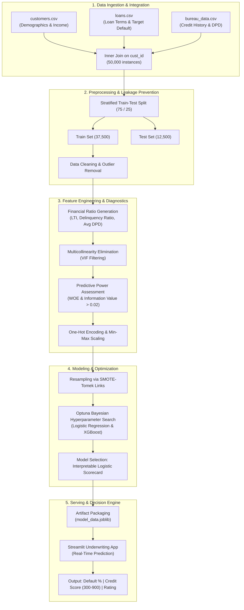

# 📊 Credit Risk Modeling & Scoring Engine

[](https://www.python.org/)
[](https://streamlit.io/)
[](https://optuna.org/)
[](https://scikit-learn.org/)
[](#model-performance--validation)
[](#model-performance--validation)

---

## 📌 Executive Summary

**Credit Risk Modeling & Scoring Engine** is an enterprise-grade financial machine learning solution engineered to evaluate loan applicant default risk, compute standardized credit scores (300–900 scale), and assign risk ratings in real time.

Built on historical applicant data, active loan profiles, and credit bureau records (**50,000+ borrowers**), this project bridges traditional banking scorecards with modern automated machine learning:
- Resolves acute data challenges: severe class imbalance, multicollinearity, and skewed distributions.
- Applies rigorous statistical feature screening (**VIF**, **Weight of Evidence (WOE)**, and **Information Value (IV)**).
- Employs **SMOTE-Tomek** resampling coupled with **Optuna** Bayesian hyperparameter optimization.
- Delivers an interpretable, regulatory-compliant **Logistic Regression Scorecard** with **0.984 ROC-AUC** and **0.967 Gini Coefficient**.
- Deploys an interactive **Streamlit web application** for real-time underwriting risk assessment.

---

## 🏗️ System Architecture & Workflow



---

## 🌟 Key Features & Capabilities

### 1. Robust Data Integration & Leakage-Free Design
- **Multi-Source Ingestion**: Merges customer demographic profiles, loan disbursement details, and historical bureau reporting into a single 360° borrower view.
- **Strict Leakage Prevention**: Enforces stratified train-test splitting *prior* to Exploratory Data Analysis (EDA), outlier imputation, and scaling parameters fitting.

### 2. Domain-Specific Feature Engineering
- **Loan-to-Income (LTI) Ratio**: Captures borrower debt leverage ($\frac{\text{Loan Amount}}{\text{Income}}$).
- **Delinquency Ratio**: Ratio of delinquent repayment periods against total loan tenure ($\frac{\text{Delinquent Months}}{\text{Total Loan Months}}$).
- **Average DPD per Delinquency**: Severity metric evaluating Days Past Due accumulated per delinquency event ($\frac{\text{Total DPD}}{\text{Delinquent Months}}$).

### 3. Rigorous Statistical Feature Selection
- **Multicollinearity Removal (VIF)**: Identifies and removes highly correlated variables (e.g., sanction amount, processing fee, net disbursement, principal outstanding).
- **Information Value (IV) & Weight of Evidence (WOE)**: Ranks features by default discriminative power, retaining only attributes with strong predictive capacity ($\text{IV} > 0.02$).

### 4. Advanced Class Imbalance Handling
- Mitigates skewed target distributions using **SMOTE-Tomek** (Synthetic Minority Over-sampling Technique combined with Tomek Link boundary clean-up), ensuring robust boundary delineation without noisy synthetic artifacts.

### 5. Automated Hyperparameter Optimization (Optuna)
- Employs **Tree-structured Parzen Estimator (TPE)** via Optuna across 50+ trials with 3-fold cross-validation to maximize Macro F1-Score.

### 6. Regulatory-Ready Credit Scorecard & Rating Matrix
- Transparent logistic formula translates raw default probability into an industry-standard **300 to 900 Credit Score**.
- Categorizes applicants into intuitive risk tiers: **Poor**, **Average**, **Good**, and **Excellent**.

### 7. Real-Time Production Streamlit Interface
- Clean, responsive dashboard enabling credit underwriters to input loan applicant data and receive instantaneous risk calculations and credit ratings.

---

## 📁 Repository Structure

```plaintext
Project2_Optuna_MFT_Resources/
├── README.md                              # Comprehensive project documentation
├── credit_risk_model_codebasics.ipynb     # Complete end-to-end research & experimentation notebook
├── app/                                   # Production application directory
│   ├── main.py                            # Streamlit UI dashboard
│   ├── prediction_helper.py               # Feature preprocessing, scaling & scoring pipeline
│   └── artifacts/                         # App-specific serialized pipeline
│       └── model_data.joblib              # Model, scaler, feature list & metadata
├── artifacts/                             # Exported training artifacts
│   └── model_data.joblib                  # Serialized production model dictionary
└── dataset/                               # Raw relational dataset files
    ├── customers.csv                      # Demographics, employment, and income data (50k rows)
    ├── loans.csv                          # Loan specifications, dates, amounts, and default target (50k rows)
    └── bureau_data.csv                    # Historical bureau payment tracking, DPD, open accounts (50k rows)
```

---

## 📊 Dataset Overview

The training dataset originates from 50,000 credit records across three relational tables joined on `cust_id`:

| Dataset File | Key Columns Included | Description |
| :--- | :--- | :--- |
| `customers.csv` | `cust_id`, `age`, `gender`, `marital_status`, `employment_status`, `income`, `number_of_dependants`, `residence_type`, `years_at_current_address`, `zipcode` | Socio-demographic indicators and borrower stability metrics. |
| `loans.csv` | `loan_id`, `loan_purpose`, `loan_type`, `sanction_amount`, `loan_amount`, `processing_fee`, `gst`, `net_disbursement`, `loan_tenure_months`, `principal_outstanding`, `bank_balance_at_application`, `default` | Contract specifications, loan terms, and target label (`default`: 0 = Non-Default, 1 = Default). |
| `bureau_data.csv` | `number_of_open_accounts`, `number_of_closed_accounts`, `total_loan_months`, `delinquent_months`, `total_dpd`, `enquiry_count`, `credit_utilization_ratio` | External credit bureau repayment history, delinquency count, and credit exposure. |

---

## 🔬 Statistical Screening & Feature Selection

### 1. Multicollinearity Filtering (Variance Inflation Factor)
Multi-collinear variables distort logistic regression coefficients and diminish model interpretability. Calculating VIF revealed severe collinearity among financial disbursement attributes:

$$\text{VIF}_i = \frac{1}{1 - R_i^2}$$

- **Pruned Features**: `sanction_amount`, `processing_fee`, `gst`, `net_disbursement`, and `principal_outstanding` exhibited near-infinite VIF values and were removed.
- **Retained Core Features**: Kept clean predictors with acceptable VIF ($< 6.5$).

### 2. Information Value (IV) & Weight of Evidence (WOE)
Information Value was computed for all categorical and binned numerical candidates:

$$\text{WOE} = \ln\left(\frac{\% \text{ Non-Defaulters (Good)}}{\% \text{ Defaulters (Bad)}}\right)$$

$$\text{IV} = \sum \left(\% \text{ Good} - \% \text{ Bad}\right) \times \text{WOE}$$

```
+-----------------------------------+--------------------+------------------------+
| Feature Name                      | Information Value  | Predictive Strength    |
+-----------------------------------+--------------------+------------------------+
| credit_utilization_ratio          | 2.353              | Suspiciously High      |
| delinquency_ratio                 | 0.717              | Strong Predictor       |
| loan_to_income (LTI)              | 0.476              | Strong Predictor       |
| avg_dpd_per_delinquency           | 0.402              | Strong Predictor       |
| loan_purpose                      | 0.369              | Medium-Strong          |
| residence_type                    | 0.247              | Medium Predictor       |
| loan_tenure_months                | 0.219              | Medium Predictor       |
| loan_type                         | 0.163              | Medium Predictor       |
| age                               | 0.089              | Weak-Medium Predictor  |
| number_of_open_accounts           | 0.043              | Weak Predictor         |
+-----------------------------------+--------------------+------------------------+
```

Features with $\text{IV} > 0.02$ were chosen for final scorecard training, eliminating noise from uninformative fields like `gender`, `marital_status`, and `zipcode`.

---

## 🧪 Model Experimentation & Iterations

Four controlled experimentation phases were conducted to evaluate model families, resampling techniques, and hyperparameter tuning:

```
                                  EXPERIMENTATION MATRIX
  +-------------+---------------------+-------------------+---------------------+------------------+
  | Iteration   | Model Algorithm     | Imbalance Handler | Hyperparameter Tech | Default Recall   |
  +-------------+---------------------+-------------------+---------------------+------------------+
  | Attempt 1   | Logistic / RF / XGB | None (Raw Data)   | Baseline / RandomCV | ~0.52 (Poor)     |
  | Attempt 2   | Logistic / XGBoost  | Under-Sampling    | Baseline            | ~0.89 (High Bias)|
  | Attempt 3   | Logistic Regression | SMOTE-Tomek       | Optuna (3-Fold CV)  | 0.94 (Optimal)   |
  | Attempt 4   | XGBoost Classifier  | SMOTE-Tomek       | Optuna (3-Fold CV)  | 0.86             |
  +-------------+---------------------+-------------------+---------------------+------------------+
```

### Why Logistic Regression was Finalized:
While **XGBoost** reached high overall accuracy (0.96) and Macro F1 (0.976), **Logistic Regression with SMOTE-Tomek** was chosen as the production model because:
1. **Higher Default Recall (0.94 vs 0.86)**: In lending, missing a default (False Negative) is exponentially more expensive than rejecting a borderline borrower (False Positive).
2. **Regulatory & Audit Transparency**: Banking frameworks (Basel accords, FCRA, ECOA) require clear, explainable coefficients for loan approval and adverse action notices.
3. **Seamless Scorecard Mapping**: Linear log-odds can be directly projected into points-based credit scorecards without complex post-hoc explainers.

---

## 📈 Model Performance & Validation

### 1. Classification Metrics (Test Set: 12,497 samples)

```
              precision    recall  f1-score   support

Non-Default (0)    0.99      0.93      0.96     11,423
    Default (1)    0.57      0.94      0.71      1,074

       accuracy                        0.93     12,497
      macro avg    0.78      0.94      0.83     12,497
   weighted avg    0.96      0.93      0.94     12,497
```

### 2. Credit Risk Industry Validation Metrics
- **ROC-AUC Score**: `0.9836` (exceptional class separation between good and bad borrowers)
- **Gini Coefficient**: `0.9673` ($2 \times \text{AUC} - 1$)
- **Kolmogorov-Smirnov (KS) Statistic**: Peak cumulative difference between defaulter and non-defaulter distributions, confirming strong separation.
- **Decile Rank Ordering**: Monotonic risk progression across all 10 deciles (top deciles capture $>90\%$ of total defaults).

---

## 🧮 Credit Score Calculation Engine

The prediction pipeline maps the logistic log-odds into default probability, then calculates a standardized credit score:

$$\ln\left(\frac{P(\text{Default})}{1 - P(\text{Default})}\right) = \boldsymbol{\beta}^T \mathbf{X} + \beta_0$$

$$P(\text{Default}) = \frac{1}{1 + e^{-(\boldsymbol{\beta}^T \mathbf{X} + \beta_0)}}$$

$$P(\text{Non-Default}) = 1 - P(\text{Default})$$

$$\text{Credit Score} = \text{Base Score} + \left(P(\text{Non-Default}) \times \text{Scale Length}\right)$$

Where:
- $\text{Base Score} = 300$
- $\text{Scale Length} = 600$
- Resulting Range: **300 to 900**

### Risk Rating Tiers

| Credit Score Range | Risk Rating Category | Underwriting Action |
| :---: | :---: | :--- |
| **750 – 900** | 🟢 **Excellent** | Instant Approval / Preferred Interest Rates |
| **650 – 749** | 🔵 **Good** | Standard Approval / Regular Terms |
| **500 – 649** | 🟡 **Average** | Manual Underwriting / Collateral Required |
| **300 – 499** | 🔴 **Poor** | High Risk of Default / Application Decline |

---

## 🚀 Quickstart & Installation

### Prerequisites
- Python 3.9, 3.10, or 3.11 installed
- Git

### 1. Clone the Repository
```bash
git clone https://github.com/barbadikaramey-cloud/Credit-Risk-Modeling-Scoring-Engine.git
cd Credit-Risk-Modeling-Scoring-Engine
```

### 2. Create and Activate a Virtual Environment
```bash
# macOS/Linux
python3 -m venv .venv
source .venv/bin/activate

# Windows
python -m venv .venv
.venv\Scripts\activate
```

### 3. Install Dependencies
```bash
pip install --upgrade pip
pip install numpy pandas scikit-learn xgboost optuna imbalanced-learn statsmodels joblib matplotlib seaborn streamlit
```

*(Or via `requirements.txt` if created)*

### 4. Run the Streamlit Application
Navigate into the `app` folder and launch the server:
```bash
cd app
streamlit run main.py
```

The application will be accessible at: `http://localhost:8501`

---

## 💻 Streamlit Web Application Usage

The interactive app allows risk officers to input customer attributes and obtain instant risk decisions:

1. **Applicant Financial Profile**:
   - Age (years)
   - Annual Income (₹ / $)
   - Requested Loan Amount
   - Calculated **Loan to Income (LTI) Ratio** (automatically computed)
2. **Repayment & Bureau Behavior**:
   - Loan Tenure (months)
   - Average Days Past Due (Avg DPD)
   - Delinquency Ratio (%)
   - Credit Utilization Ratio (%)
   - Number of Active Open Accounts
3. **Categorical Attributes**:
   - Residence Type (`Owned`, `Rented`, `Mortgage`)
   - Loan Purpose (`Education`, `Home`, `Auto`, `Personal`)
   - Loan Type (`Secured`, `Unsecured`)
4. **Instant Underwriting Output**:
   - **Default Probability**: Percentage probability of customer defaulting.
   - **Credit Score**: Calibrated 300–900 score.
   - **Rating**: Color-coded risk status (Poor, Average, Good, Excellent).

---

## 📦 Exported Artifacts

The serialized file `artifacts/model_data.joblib` contains everything required for self-contained, reproducible inference:

```python
model_data = {
    'model': final_model,        # Calibrated Logistic Regression model
    'features': features,        # 13 final encoded feature names
    'scaler': scaler,            # Fitted MinMaxScaler instance
    'cols_to_scale': cols_to_scale  # Columns requiring transformation
}
```

---

## 🔮 Future Roadmap & Production Enhancements

- [ ] **SHAP / LIME Integration**: Add real-time visual explanations explaining the top 3 positive and negative factors driving an individual's credit score.
- [ ] **API Serving (FastAPI)**: Wrap the prediction engine with asynchronous REST APIs and OpenAPI / Swagger documentation.
- [ ] **Dockerization & CI/CD**: Package application into Docker containers with GitHub Actions automated testing and deployment.
- [ ] **Model Monitoring & Drift Detection**: Implement Evidently AI / Prometheus monitoring to track data drift and concept drift over time.
- [ ] **Alternative Credit Scoring**: Incorporate non-traditional data (utility bills, digital transaction velocity) for thin-file applicants.

---

## 📜 License & Acknowledgements

- **Course Reference**: Project structure inspired by the *Codebasics Machine Learning & Data Science Course*.
- **License**: Distributed under the MIT License. See `LICENSE` for more information.

---
*Developed with precision for financial institutions seeking explainable, high-performance credit scoring.*

